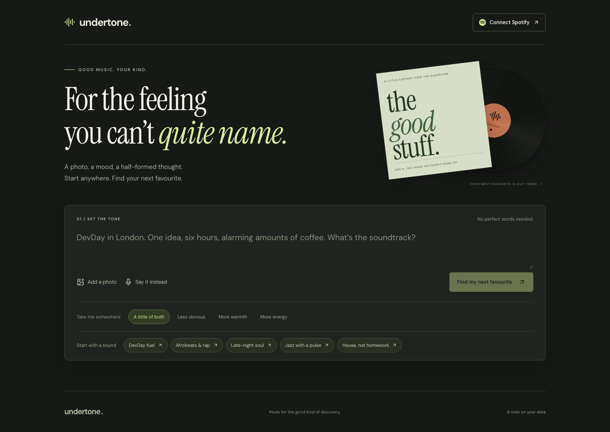

# Undertone

**A photo, a mood, a half-formed thought. Find your next favourite.**

**[Try the live app](https://devday-music.vercel.app)** · **[Watch the 45-second demo](https://github.com/tobiadey/devday-music/releases/download/hackathon-demo/undertone-demo.mp4)**

No account needed for guest discovery.



A fresh music-discovery web app built for DevDay Exchange London, 1 November 2026. `devday-music` is the repository name; Undertone is the working product name.

## The complete journey

1. Describe the sound you want, record a spoken request, or upload a photo with optional text.
2. Review/edit a voice transcription before sending it.
3. Get up to six catalogue-verified songs with a musical reason for each suggestion.
4. Hear a preview, open the song in a music service, save a find or hide a miss.
5. Make original artwork for an individual song, or restore its original cover.
6. Edit your request or ask for a fresh selection. The composer steps aside while you explore results.

Guest discovery works without an account, using Apple's catalogue for song verification, promotional previews and store links. Spotify connection adds catalogue lookup, listening seeds and Spotify's embedded player. A Spotify seed searches adjacent genres, verifies candidate artists’ own genre metadata, and excludes known tracks. It is deliberately separate from the AI request path. Genre overlap is a discovery heuristic, not a guarantee of taste.

## Run locally

Requires Node.js 22+ and npm.

```sh
npm ci
cp .env.example .env.local
# Fill in OPENAI_API_KEY for guest discovery.
# For Spotify, also fill in SPOTIFY_CLIENT_ID, APP_URL and SESSION_SECRET.
npm run dev
```

Open **http://127.0.0.1:3000**. Generate a session secret with `openssl rand -hex 32`. Keep all values in the ignored `.env.local`; never commit them.

`OPENAI_MODEL` defaults to `gpt-6-luna`, checked against the model list during this build. Voice transcription uses `gpt-transcribe`. Original cover generation defaults to `gpt-image-2.5-flare` (`OPENAI_IMAGE_MODEL` can override it). Access depends on your OpenAI project. API use is billed to the configured key.

### Spotify setup

Use Spotify's Authorization Code with PKCE. In the [Spotify Developer Dashboard](https://developer.spotify.com/dashboard), open your app's settings and register the production redirect URI:

```text
https://devday-music.vercel.app/api/auth/callback
```

For other deployments, use `${APP_URL}/api/auth/callback`. Locally, register `http://127.0.0.1:3000/api/auth/callback`, not `localhost`. No Spotify client secret is required.

**Spotify access, checked 1 November 2026:**

- Standard development mode supports **up to five manually allowlisted Spotify users per developer app**. The owner needs Spotify Premium; the owner account was observed working without a manual entry. This is an account allowance, not a concurrent-session limit.
- Add each tester’s name and Spotify account email under **Settings → Users Management / Users and Access → Add user**, then send them the app link yourself. A user outside the allowlist may sign in but receive API errors. No public API is documented for automatic self-enrolment.
- This deployment currently uses Auricle's developer app, so both share its allowance. Existing apps already above five before the 2026 changes may retain their users.
- Wider access requires Spotify's extended-quota approval. Guest discovery does not use Spotify sign-in or consume these account slots, but still has provider/demo rate limits.

Sources: [quota modes](https://developer.spotify.com/documentation/web-api/concepts/quota-modes), [2026 migration](https://developer.spotify.com/documentation/web-api/tutorials/february-2026-migration-guide). Spotify playback also depends on account, region and widget availability.

## Checks

```sh
npm test
npm run typecheck
npm run build
```

Thirteen focused tests cover recording verification, exclusions/diversity, image-only input and file validation, genre-match verification, input limits, encoded links, encrypted cookie tampering, origin checks, Spotify-to-AI exclusion boundaries and demo rate limits. Local live checks exercised image-based discovery, original cover generation with and without an image reference, text discovery, real catalogue lookup, browser playback and synthetic voice transcription. See [BUILD_LOG.md](BUILD_LOG.md) for evidence and limitations.

## Data and limits

- Independently supplied text, transcribed voice preferences and uploaded photos enter AI requests. Spotify content and listening history do not. Cover generation receives only the user’s independent creative brief/photo; it does not receive provider artwork or song metadata.
- OAuth tokens use encrypted, HttpOnly cookies with PKCE/state validation. Disconnect clears the session and locally saved Spotify finds.
- Saved finds stay in this browser. Personal covers last for the current results view and are not uploaded to Spotify or saved across reloads. Original provider artwork remains attributed. No database, uploaded-audio storage, background listening or song fingerprinting.
- Song existence is verified by title and artist. This does not prove every AI-written musical description is correct. Unconfirmed suggestions are omitted.
- Photos are resized in the browser and accepted as JPEG, PNG or WebP. Cover generation has a best-effort limit of five requests per hour per IP per instance.
- Per-instance demo limits reduce API spend; they are not distributed abuse protection. Configure platform limits and a project budget before wider promotion.
- Apple's search API has a modest request quota; guest results can be fewer than six. Music is streamed from its provider, not downloaded or bundled.

## Stack and credits

Next.js, React, TypeScript, Vercel AI SDK with the OpenAI provider, OpenAI vision, transcription and image generation, Spotify Web API/Embeds, Apple iTunes Search API, Lucide icons, Zod and Playwright.

Auricle, an existing private AdeyStudios project, inspired the direction. **No Auricle source code or assets were copied.** The application code and record-sleeve illustration were created during this hackathon. The illustration uses CSS; no generated artwork is required for the core journey.

Design used the [AdeyStudios web-design skill](https://github.com/AdeyStudios/skills). Typography: DM Sans and Instrument Serif from Google Fonts, under their open font licences. Album artwork, song previews and Spotify marks belong to their respective owners. The iTunes badge is Apple's official artwork from its [identity guidelines](https://marketing.services.apple/itunes-identity-guidelines). Song previews are provided courtesy of iTunes. iTunes and the iTunes Store are trademarks of Apple Inc., registered in the U.S. and other countries.

Codex checked current documentation, wrote the application, caught an origin-check failure during live testing, added regression coverage, and exercised the real discovery/preview flow. [Build log](BUILD_LOG.md).

[Submission draft](docs/SUBMISSION.md) includes the product description, links and Codex example.

## Submission status

- [x] Public repository and reproducible setup
- [x] Local end-to-end guest discovery and preview
- [x] Public deployment verified without authentication
- [x] Spotify callback and signed-in listening/player flow confirmed by the founder; one-click embed preview also checked separately
- [x] Demo video, 45 seconds, public download checked
- [ ] Submit project and team details by 17:00 London

Official references: [OpenAI docs](https://developers.openai.com/), [Codex](https://developers.openai.com/codex), [Spotify PKCE](https://developer.spotify.com/documentation/web-api/tutorials/code-pkce-flow), [Spotify 2026 migration](https://developer.spotify.com/documentation/web-api/tutorials/february-2026-migration-guide), [Spotify policy](https://developer.spotify.com/policy), [Apple catalogue API](https://performance-partners.apple.com/search-api).
